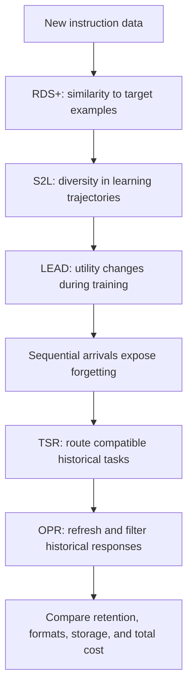

# Five linked reproductions: from useful training data to useful replay memory

**Last updated:** 2026-10-02. **Primary artifact:** `results/literature-review/small-model-selection/five-linked-reproductions-2026-10-02.md`. **Scope:** five complete-method reproductions for the cost-efficient incremental fine-tuning idea in [Idea.md](/Idea.md), with every learner and auxiliary model at or below 1B parameters. This focused recommendation supersedes the reproduction order in the [15-paper review](/results/literature-review/small-model-selection/six-recent-selection-papers-2026-09-30.md); that broader review remains the background literature map. **Status:** papers and official repositories inspected; no dependencies installed, training run, or reproduction result obtained.

The recommended five are **RDS+, SmallToLarge (S2L), LEAD, Transfer-Selective Replay (TSR), and On-Policy Replay (OPR)**. Reproduce each complete algorithm before modifying it. RDS+, S2L, and LEAD provide progressively richer answers to which training examples are useful; TSR and OPR then ask which historical examples to replay and what responses those examples should contain. This creates a research narrative while preserving five independently assessable reproductions.

The recent window is **2024-10-02 to 2026-10-02**, accepting either first public release or peer-reviewed publication. S2L was published at NeurIPS 2024, although its March 2024 first preprint predates that window. LEAD is a **2025 PVLDB publication**, with its repository advertising the associated VLDB 2026 conference. RDS+, TSR, and OPR are preprints; they should not be presented as accepted conference papers. [S2L proceedings](https://proceedings.neurips.cc/paper_files/paper/2024/hash/97fe251c25b6f99a2a23b330a75b11d4-Abstract-Conference.html), [LEAD publication](https://www.vldb.org/pvldb/vol19/p426-luo.pdf).

## The story that links the reproductions

**Project title:** *From Data Selection to Replay: Reproducing Five Methods for Efficient Small-Model Updates*.

**Central question:** When training data arrives in stages, which definition of a useful example best balances learning new tasks, retaining old tasks, and total update cost?



The arrows express successive questions, **not an instruction to concatenate the algorithms**. First establish whether static representation similarity, small-model learning dynamics, or adaptive training feedback chooses better current data. Then establish whether replay should prioritize compatibility with the incoming task or consistency with the model's current output distribution. The connection is the changing meaning of data utility across an update's lifetime. A persuasive course report can present the resulting agreements and disagreements without inventing a sixth algorithm.

The project has two experimental settings because the papers address two different problems. The first three are originally instruction/SFT subset selectors; the final two are originally continual-learning systems. Reproducing all five does not require falsely calling the first three published replay algorithms. Their later use for choosing retained history is a clearly labeled extension after their original selection mechanisms have been reproduced.

## Selection and feasibility matrix

| Paper | Distinct mechanism to reproduce | Published small-model evidence | Planned course setting | Code and principal risk |
|---|---|---|---|---|
| [RDS+](https://arxiv.org/abs/2503.01807), March 2025 preprint | Position-weighted decoder representations, cosine scoring, query/task aggregation and round-robin selection | Main learners are 7–8B | Complete selector with Qwen2.5-0.5B-Instruct; reduced public pool | [Official code](https://github.com/hamishivi/automated-instruction-selection); query coverage and representation quality may change at 0.5B |
| [S2L](https://proceedings.neurips.cc/paper_files/paper/2024/hash/97fe251c25b6f99a2a23b330a75b11d4-Abstract-Conference.html), NeurIPS 2024 | Train a small proxy, cluster per-example loss trajectories, sample across clusters | **Pythia-70M proxy and Pythia-410M learner** | Native small-model MathInstruct reproduction first; Qwen-0.5B matched comparison second | [Official code](https://github.com/BigML-CS-UCLA/S2L); proxy training and trajectory extraction must be included in cost |
| [LEAD](https://www.vldb.org/pvldb/vol19/p426-luo.pdf), PVLDB 2025 | Warmup/offline clustering, EXP3 cluster scheduler, IDU fine selection and feedback | Published principal learners are 7–8B | Entire pipeline with Qwen-0.5B and a smaller candidate pool | [Official code](https://github.com/HKUSTDial/LEAD) is marked **under construction**; highest integration effort |
| [TSR](https://arxiv.org/abs/2607.15587), July 2026 preprint | Shared-initialization gradient signatures, source routing, replay and snapshot distillation | **Qwen2.5-0.5B-Instruct** on TRACE/NumGLUE | Official 0.5B configuration first | [Official code](https://github.com/ymeng3/transfer-selective-replay); memory and era snapshots grow with tasks |
| [OPR](https://arxiv.org/abs/2605.29495), May 2026 preprint | Generate old-prompt responses, filter with the published scorer, mix into ordinary SFT | Published principal learners are 7–8B | Complete OPR-SC at Qwen-0.5B; OPR-RU where official labels/scorers are available | [Official code](https://github.com/Yancey2024/OnPolicyReplay); small models may confidently generate incorrect replay targets |

**Meaning of reproduction:** S2L and TSR have published sub-1B configurations that can be targeted directly. For RDS+, LEAD, and OPR, retain all algorithmic components while changing model and pool scale; describe these as **scaled algorithm reproductions**, not replications of the published headline scores. All five remain actual implementations and experiments, rather than references that merely motivate one implementation. Visible source code is evidence of availability, not evidence that a repository installs or runs successfully.

Use **Qwen2.5-0.5B-Instruct** as the common learner after the native checks, **Pythia-70M** as the S2L proxy, and **Pythia-410M** only for S2L's native check. OPR-SC avoids an external reward model, and TSR's saved references are adapters on the same small backbone. Do not introduce a larger teacher or embedding model while claiming the whole experiment respects the 1B limit. TSR's README says its 0.5B configuration fits one GPU with approximately 16GB VRAM; this is an author claim about that configuration, not a measured resource guarantee for all five. [Qwen checkpoint](https://huggingface.co/Qwen/Qwen2.5-0.5B-Instruct), [TSR configuration and resource guidance](https://github.com/ymeng3/transfer-selective-replay).

## 1. RDS+ — useful because it resembles the target

**Citation:** Hamish Ivison, Muru Zhang, Faeze Brahman, Pang Wei Koh, and Pradeep Dasigi. *Large-Scale Data Selection for Instruction Tuning*. 2025 preprint, arXiv:2503.01807. [Paper](https://arxiv.org/html/2503.01807) · [PDF](https://arxiv.org/pdf/2503.01807) · [Code](https://github.com/hamishivi/automated-instruction-selection).

### Idea

RDS+ selects instruction-response examples resembling a labeled target query set in the learner's representation space. It pools the decoder's final-layer token states with increasing position weights and computes cosine similarity between queries and candidate records. A round-robin procedure prevents selection from being driven entirely by a single query, with task aggregation for multi-task selection. The intended setting is selecting a training subset before instruction tuning, rather than choosing replay minibatches during continual learning. [Method, §3](https://arxiv.org/html/2503.01807).

### Novelty

The distinctive algorithmic change is the tuned position-weighted representation and its practical selection procedure. Similarity-based selection and decoder representations themselves are established techniques. The broader paper's contribution includes testing automatic selectors at much larger instruction-data scale, rather than introducing a new fine-tuning loss. For this project, implementing RDS+ establishes the representation-based reference against which more expensive selection signals can be judged. [Paper](https://arxiv.org/pdf/2503.01807).

### Results

The Tülu 3 comparison reports **76.1** for RDS+ versus **74.7** for balanced random selection. Another setting obtains **50.8** using approximately **326K** selected examples from a **5.8M** pool, compared with **50.9** for the full pool. These are results on the authors' larger instruction-tuned models, not expected scores for the proposed 0.5B learner. The useful reproduction question is whether its advantage over balanced random selection persists as the model and candidate pool shrink. [Tables and scaling analysis](https://arxiv.org/html/2503.01807).

### Limitations

Selection depends on how well the target queries describe the eventual tasks. It also assumes that small-model hidden-state geometry is useful enough to rank examples, which the project's scaled setting must test. A tiny candidate pool can make the scoring cost exceed the training saved, even if accuracy improves. Inspection of the official repository does not establish compatibility with the proposed checkpoint, so a small scoring-to-training run is the first practical gate. [Official repository](https://github.com/hamishivi/automated-instruction-selection).

### Relevance

RDS+ is the first actual reproduction in the current-data selection part of the incremental fine-tuning project. It asks whether a simple static signal already gives most of the benefit obtainable from selection. Its later application to memory writing tests whether target resemblance is sufficient for retaining historical knowledge, but that application is an extension of the original setting. **Threat level: high** to a claimed new similarity-based selector, because the core algorithm already exists.

## 2. SmallToLarge — useful because it represents a learning pattern

**Citation:** Yu Yang, Siddhartha Mishra, Jeffrey Chiang, and Baharan Mirzasoleiman. *SmallToLarge (S2L): Scalable Data Selection for Fine-tuning Large Language Models by Summarizing Training Trajectories of Small Models*. NeurIPS 2024, arXiv:2403.07384. The conference PDF uses “Training Loss Trajectories” in its title. [Proceedings](https://proceedings.neurips.cc/paper_files/paper/2024/hash/97fe251c25b6f99a2a23b330a75b11d4-Abstract-Conference.html) · [Paper](https://proceedings.neurips.cc/paper_files/paper/2024/file/97fe251c25b6f99a2a23b330a75b11d4-Paper-Conference.pdf) · [Code](https://github.com/BigML-CS-UCLA/S2L).

### Idea

S2L trains a small proxy and records how each candidate example's loss changes during training. It clusters the resulting trajectory vectors, then samples approximately equal numbers of examples across clusters to preserve different learning patterns. The selected subset trains a separate target model. Its published Pythia-70M-to-Pythia-410M configuration makes it a direct small-language-model reproduction candidate, without requiring a vision-to-text port. [Experiments, §5.2](https://arxiv.org/html/2403.07384).

### Novelty

The main algorithmic contribution is using entire small-model loss trajectories as the representation for subset construction. This differs from selecting examples solely by their final loss or total loss reduction. Clustering and uniform sampling remain familiar operations, while the paper adds an analysis linking similar trajectories to similar gradients under stated assumptions. That analysis motivates the selector but should not be treated as a universal guarantee for arbitrary nonconvex language-model fine-tuning. [Conference paper, §§3–4](https://proceedings.neurips.cc/paper_files/paper/2024/file/97fe251c25b6f99a2a23b330a75b11d4-Paper-Conference.pdf).

### Results

For Pythia-410M on MathInstruct, the paper reports that **30K examples**, approximately **11%** of the full training set, match or exceed full-data performance. The comparison uses the **same total training steps**, so selected examples are reused more often. The authors report a **4.7%** average improvement over the runner-up across six math evaluation datasets at that selection size. This is an especially useful anchor because the target model itself meets the user's parameter budget; reproducing only a much smaller pool should still be labeled a scaled data setting. [Published setup and results](https://arxiv.org/html/2403.07384).

### Limitations

The proxy trains on the candidate pool before the target is trained, so selection is not free. Loss trajectories can cluster examples by response length or formatting rather than only by knowledge, which is an empirical question for the proposed comparison. The conference reproducibility checklist says that error bars were not reported because of computational cost. Matching optimizer steps also does not demonstrate that the entire proxy-plus-target pipeline costs less than full-data training. [Conference paper and checklist](https://proceedings.neurips.cc/paper_files/paper/2024/file/97fe251c25b6f99a2a23b330a75b11d4-Paper-Conference.pdf).

### Relevance

S2L is the second actual reproduction and tests whether learning behavior captures useful differences missed by RDS+ geometry. The native 70M/410M experiment gives the course project a strong verification anchor before changing to the common Qwen learner. Its later memory-writing extension asks whether representatives of initial learning trajectories remain useful after additional updates. **Threat level: high** to a new claim based only on small-model trajectory clustering, since that mechanism is already the paper's contribution.

## 3. LEAD — useful according to the model's current training state

**Citation:** Xiaotian Lin, Yanlin Qi, Yizhang Zhu, Themis Palpanas, Chengliang Chai, Nan Tang, and Yuyu Luo. *LEAD: Iterative Data Selection for Efficient LLM Instruction Tuning*. PVLDB 19(3):426–439, 2025, DOI:10.14778/3778092.3778103; arXiv:2505.07437. [Published paper](https://www.vldb.org/pvldb/vol19/p426-luo.pdf) · [Method HTML](https://arxiv.org/html/2505.07437) · [Code](https://github.com/HKUSTDial/LEAD).

### Idea

LEAD changes which data is selected as fine-tuning progresses. Its Instance-Level Dynamic Uncertainty utility combines observed training loss, an approximation of post-update loss change, and smoothed historical signals. A coarse scheduler chooses difficulty clusters through an EXP3 bandit, followed by finer utility-based selection within task clusters. The full method includes warmup and offline processing as well as online selection, so reproducing only a smoothed-loss ranking would omit substantial parts of LEAD. [Method, §§3–5](https://arxiv.org/html/2505.07437).

### Novelty

The central contribution is extracting adaptive utility from signals produced during ordinary training instead of repeatedly rescoring the entire pool. The particular IDU construction and its integration with the cluster scheduler distinguish the method from static selection. Clustering, bandits, and exponential smoothing are adapted building blocks rather than new inventions. Its theoretical derivations depend on approximation assumptions, which the small-model reproduction should audit with measured loss changes on a diagnostic batch. [Method and theory](https://arxiv.org/html/2505.07437).

### Results

The published Llama-3.1-8B comparison reports an average score of **66.62**, **6.31 points** above full-data training. The main selection budget is **15K**, approximately **2.5%** of its candidate pool. The paper also reports training-time reductions of **5–10×** in its original hardware and model configurations. None of those numbers establishes the advantage or resource requirement of the proposed 0.5B reproduction, particularly after counting setup and warmup. [Published results](https://www.vldb.org/pvldb/vol19/p426-luo.pdf).

### Limitations

The official repository remains marked as under construction, despite showing offline, online, training, and evaluation modules. Its documented workflow starts with a random 6K-example warmup model and pool preprocessing, which adds cost before adaptive training starts. Stale scores, cold-start clusters, and differences between estimated and true loss change can affect selection. LEAD therefore has the largest implementation risk in this shortlist, and its smoke run must cover the complete pipeline rather than only the utility function. [Repository and documented stages](https://github.com/HKUSTDial/LEAD).

### Relevance

LEAD is the third actual reproduction and closes the current-data story by making selection responsive to the learner. Comparing it with RDS+ and S2L asks whether dynamic feedback justifies its additional state and integration effort. The later continual extension must restrict utility state to legally retained candidates instead of preserving an unbounded historical pool. **Threat level: high** to claiming novelty merely from updating example priorities using training losses and a bandit scheduler.

## 4. Transfer-Selective Replay — useful because an old task helps the new one

**Citation:** Yang Meng, Zhenya Liu, Zhuokai Zhao, and Yuxin Chen. *Rethinking Transfer in Continual Learning: A Replay-Based Realisation*. July 2026 preprint, arXiv:2607.15587. [Paper](https://arxiv.org/html/2607.15587) · [PDF](https://arxiv.org/pdf/2607.15587) · [Code](https://github.com/ymeng3/transfer-selective-replay).

### Idea

TSR records task signatures from gradients at a fixed shared LoRA initialization, then routes historical replay according to signature alignment with the incoming task. The learner continues training one accumulating adapter rather than resetting it at every task. Saved task-era adapter references provide a separate distillation term for stability. Its published Qwen2.5-0.5B setting allows an actual native small-model continual-learning reproduction. [Algorithm and configuration](https://arxiv.org/html/2607.15587).

### Novelty

The distinctive design assigns replay to transfer and snapshot distillation to retention. Its shared-initialization gradient signatures estimate compatibility without fitting every source-target pair at each arrival. Neither replay nor distillation alone is new, and gradient alignment is an established family of signals. The reproduction should preserve this division of roles, since replay routing without the reference term is an ablation rather than the full published TSR method. [TSR, §§4–5](https://arxiv.org/html/2607.15587).

### Results

In its Qwen-0.5B TRACE comparison, TSR reports an overall value of **0.475 ± 0.030**, versus **0.451 ± 0.031** for ordinary experience replay. It reports plasticity of **0.439 ± 0.017**, versus **0.427 ± 0.024**, across **five seeds**. The paper uses accuracy for classification targets and losses for generation targets, so the headline overall value must not be described as semantic accuracy over every TRACE task. Preserve the authors' reported metric and also provide the task-level results needed to interpret it. [Results and evaluation appendix](https://arxiv.org/html/2607.15587).

### Limitations

The published configuration keeps 100 historical examples per completed task, so stored data grows with task count. Era snapshots and task signatures add historical state beyond those examples. Distillation also adds reference inference, even though the backbone remains small. A later fixed-global-memory run is useful for the user's idea but changes the published storage assumption and must be reported separately from the native reproduction. [Paper configuration](https://arxiv.org/html/2607.15587), [official repository](https://github.com/ymeng3/transfer-selective-replay).

### Relevance

TSR is the fourth actual reproduction and provides the transition from current-data usefulness to historical-data usefulness. It tests whether examples should be replayed because their source task supports the next task, rather than merely because they represent past data well. Its native small-model protocol should be the first continual integration target for the common pipeline. **Threat level: high** to a proposed gradient-compatibility replay router, because both the mechanism and a sub-1B experiment already exist.

## 5. On-Policy Replay — useful because the response matches the current model

**Citation:** Yan Chen, Taojie Zhu, Meng Zhang, Xin Chen, Jiaqi Huang, Dongyang Xu, and Yizhi Wang. *On-Policy Replay for Continual Supervised Fine-Tuning*. May 2026 preprint, arXiv:2605.29495. [Paper](https://arxiv.org/html/2605.29495) · [PDF](https://arxiv.org/pdf/2605.29495) · [Code](https://github.com/Yancey2024/OnPolicyReplay).

### Idea

OPR generates responses to historical prompts using the latest checkpoint after a task has been learned. It filters those prompt-response pairs and uses the survivors as ordinary supervised replay during the next task. OPR-RU uses task-specific rule scores, while OPR-SC uses the model's length-normalized response log-probability. This changes replay content rather than adding a teacher-based loss, but still incurs historical generation and scoring cost. [Method, §3](https://arxiv.org/html/2605.29495).

### Novelty

The main contribution is putting the on-policy signal in the replay dataset itself. The training loss remains ordinary cross-entropy; generated historical responses replace fixed historical targets for the selected replay records. The paper offers a KL-shrinkage interpretation and ablations intended to separate useful filtering from merely generating any response. The whole generation-filter-SFT cycle is the reproduction target, so confidence-based selection of unchanged gold responses would reproduce a different algorithm. [Paper](https://arxiv.org/pdf/2605.29495).

### Results

At a **1%** replay budget on Qwen2.5-7B, OPR-RU reports **65.45** overall performance and **−2.29** backward transfer, versus **62.57** and **−4.27** for vanilla replay. OPR-SC reports **65.11** and **−2.08** at the same budget. At **10%**, vanilla replay is slightly higher on overall performance, **66.08** versus **65.92**, although OPR has better backward transfer. Those comparisons motivate reproducing the retention-accuracy tradeoff rather than assuming OPR dominates every measure. [Results and budget ablation](https://arxiv.org/html/2605.29495).

### Limitations

A small model can produce fluent incorrect historical responses that pass self-confidence filtering. The paper already identifies confidently incorrect outputs as a boundary of OPR-SC, which may become more consequential at 0.5B. Its small final replay set does not by itself establish small total historical storage because generation draws from a larger historical prompt pool. Reproduction should preserve that original access first, then separately measure what happens when historical candidate prompts are genuinely bounded. [Limitations and method](https://arxiv.org/html/2605.29495), [official code](https://github.com/Yancey2024/OnPolicyReplay).

### Relevance

OPR is the fifth actual reproduction and tests whether choosing the right old prompt is enough when its old answer remains fixed. It provides a complementary comparison with TSR's routing and reference-based retention. Its small-model behavior also creates a concrete format question: does response refresh retain semantic answers while weakening required output structure? **Threat level: high** to claiming that regenerating and filtering historical responses is a new replay method.

## What must be reproduced for each paper

These contracts define complete algorithms. Pool size, model size, optimizer settings, or datasets changed for course feasibility must be recorded in a paper-versus-course configuration table. A failure to reproduce the reported direction remains a valid finding if the implementation and protocol are checked; success must not be manufactured by silently dropping difficult components.

| Paper | Mandatory components | First verification experiment | Required mechanism control |
|---|---|---|---|
| RDS+ | Final decoder states; published position weighting; normalization/cosine; unique candidate selection; query round-robin and multi-task aggregation where used | Run selection then SFT against balanced random selection at an identical subset budget | Ordinary mean pooling; retain full RDS+ as the primary run |
| S2L | Train the proxy; obtain complete aligned per-example trajectories; source-aware clustering/sampling as in the math implementation; train the separate learner | Native Pythia-70M/410M on MathInstruct, comparing S2L, random, and full data under the paper's same-step setting | Final-loss-only selection; record proxy and trajectory cost separately |
| LEAD | Warmup; difficulty/task preprocessing; initial utility; EXP3 coarse scheduling; IDU fine selection and updates; published reward/state handling | Entire offline-to-online pipeline on a reduced pool, then compare with random and a static selection run | Remove the scheduler or freeze scores only as labeled ablations |
| TSR | Probe the same shared initialization; gradient-signature cosine routing; accumulating adapter; historical memories; correct era reference and distillation | Official 0.5B TRACE SeqFT/ER/TSR configuration, preserving the published per-task buffer | Uniform routing with distillation kept fixed; separately disable distillation |
| OPR | Task-boundary generation from the latest checkpoint; original history access; published SC or RU scorer; filtering; next-task replay through plain SFT | OPR-SC versus gold-target replay at 0.5B with identical candidate prompts and replay exposure | Unfiltered generation; low-score generation; SC versus RU when supported |

RDS+ uses a position weight proportional to token position, `w_i = i / sum_j j`, before pooling final-layer states. S2L's implementation details record trajectories every 500 training iterations and use Euclidean k-means with a main setting of 100 clusters; reduced-pool schedules need enough checkpoints to represent learning rather than one scalar loss. LEAD must retain its gradient-based utility-change approximation, not replace it with an unrelated per-example gradient score. TSR probes the zero-initialized LoRA factor at the shared initialization; probing the already-trained adapter changes the signature definition. OPR-SC scores generated response tokens by their average log-probability, not by maximum-token confidence. [RDS+ appendix](https://arxiv.org/html/2503.01807), [S2L appendix](https://arxiv.org/html/2403.07384), [LEAD method](https://arxiv.org/html/2505.07437), [TSR method](https://arxiv.org/html/2607.15587), [OPR scorer](https://arxiv.org/html/2605.29495).

## A practical sequence for the course project

### Stage A: native anchors and implementation fidelity

Start with the official **TSR 0.5B** sequential fine-tuning, ordinary replay, and full TSR scripts. Its published settings include LoRA rank 16, 50 current training examples per task, 100 stored examples per completed task, 500 steps per task, and a maximum sequence length of 384. Preserve the authors' settings for the native run, and do not replace its accumulating adapter or snapshots. Then run S2L's native **70M proxy / 410M learner** mathematical setting. A one-seed reduced-data smoke run checks integration; it is not a reproduction of the final published table. [TSR settings and scripts](https://github.com/ymeng3/transfer-selective-replay), [S2L published setup](https://arxiv.org/html/2403.07384).

Bring up RDS+, OPR-SC, and the complete LEAD pipeline with small candidate pools next. LEAD's early gate should show that a record travels through preprocessing, cluster scheduling, IDU update, and training without missing state. The five codebases need not be forced into one environment initially: preserve working native environments, then expose identical records, selected IDs, training/evaluation outputs, and cost logs to a shared harness. Record the exact source commit and every model/data/configuration deviation before reporting results.

### Stage B: three complete selection reproductions on the same small learner

Use Qwen-0.5B and a fixed public instruction pool containing math and short classification tasks; a **20K-record pilot pool** is a proposed starting size, not a requirement from the papers. Prefer public train records already supported by the chosen repositories, with dataset provenance and IDs retained. Use a fixed labeled calibration subset from training for RDS+ queries, then remove those IDs from the candidate pool. Reserve validation for hyperparameters and the test split for final evaluation; do not obtain queries or clusters from test examples. Keep the candidate pool and calibration-access policy identical across RDS+, S2L, LEAD, random, and task-balanced random.

Reproduce **all components** of each selector. RDS+ and S2L return static subsets, whereas LEAD returns an adaptive training schedule, so record both distinct example IDs and total repeated exposure. Compare a primary **matched training-token** budget, then a secondary same-epoch comparison to establish whether using fewer distinct records also saves training work. At two subset budgets, proposed initially as **10% and 25%**, report performance, response-format validity, selected topic/length distributions, total runtime, and retained selection state. This is the first part of the story: geometry versus learning trajectories versus current training feedback.

### Stage C: two complete replay reproductions on the same sequential stream

Keep the official TSR native result separate, then compare full TSR and full OPR on a common Qwen-0.5B TRACE-derived stream with fixed train/evaluation IDs. Preserve task ordering and prompts; a **500-example arrival cap per task** is a proposed pilot, explicitly different from TSR's 50-example native setting and OPR's 5K-example setting. Each method must be compared to ordinary replay at the same current-data and replay-token exposure. Since TSR spends work on distillation and OPR spends work on generation, report total cost and a matched-wall-time sensitivity check instead of assuming that equal optimizer steps imply equal compute.

Include new-only sequential SFT, ordinary reservoir/task-balanced replay, and cumulative-data training as references. Define cumulative incremental SFT as continuing from the preceding checkpoint on all available training history; define full retraining as restarting from the same original checkpoint on accumulated data. Those are different references, and the project's claim should name the one actually measured. The first replay comparison retains each method's original historical-access rule; it cannot yet support a fixed-storage claim.

### Stage D: link the reproduced selectors to replay memory

Only after Stages B and C, use the three reproduced selectors to choose historical records and evaluate how their current-data ranking transfers to replay. This is a **continual extension of the first three papers**, with an explicit boundary between their complete original-method reproductions and the new setting. Candidate access at update `t` is limited to the incoming train batch plus actually retained memory; discarded old records must not reappear through cached scores, embeddings, IDs pointing to a full archive, or an uncounted prompt store. Update or discard LEAD state along with candidate records, and charge any S2L proxy retraining and any persistent query anchors to the appropriate budget.

For a first linked experiment, compare RDS+, S2L, and LEAD memory-writing extensions under one fixed ordinary-replay reader. Then choose one writer by validation and compare ordinary replay, full TSR, and full OPR using the same historical candidate policy wherever feasible. This staged design avoids a large cross-product while connecting all five reproduced algorithms. Changing TSR to a fixed total buffer or restricting OPR's historical prompt archive must be labeled a bounded-access extension; keep the original-access reproduction results alongside it. No hybrid should be described as a faithful reproduction of a paper whose mechanism or access policy it changes.

## Data formatting and cost accounting

Store semantic payload and rendering metadata separately. A useful canonical record is:

```json
{
  "id": "source:split:stable-id",
  "source": "dataset-name-and-version",
  "split": "train",
  "task_id": "task-name",
  "arrival_id": 2,
  "instruction": "Return the class using the required output schema.",
  "input": "Example input",
  "semantic_target": "positive",
  "response": "{\"label\":\"positive\"}",
  "format_id": "json-label-v1",
  "template_version": "template-v1",
  "target_origin": "gold"
}
```

`semantic_target` supports semantic evaluation; `response` is the exact supervised string. For OPR, preserve the generated replay response and its origin rather than overwriting the gold record. Label-free OPR-SC buffer construction must not read the stored semantic answer; evaluation can still use independently held-out answers. Never store test answers inside candidate memory. For S2L's native experiment, keep its original serialization; use one pinned Qwen chat template and response-only loss mask for the shared comparison. Changing templates or loss normalization is a protocol change because all five methods depend directly or indirectly on tokenized responses.

| Accounting question | Quantity to log | Why it changes the conclusion |
|---|---|---|
| How much history is retained? | Historical prompt/response tokens and serialized bytes; calibration anchors and candidate archives | A 1% selected replay set can coexist with a large historical archive |
| What additional state survives updates? | Adapter snapshots, signatures, trajectories, embeddings, utility tables, cluster/bandit state | Data-example counts omit substantial state |
| What training work is repeated? | Current versus replay response tokens and total model forward/backward token counts | Small subsets can receive many epochs |
| What does selection cost? | Proxy training, scoring, preprocessing, clustering and scheduler time | A cheaper target run may have an expensive selector |
| What does replay content cost? | Historical rollout generation, filtering, teacher/reference forward passes | OPR and TSR add different forms of work |
| What accuracy is preserved? | Per-task semantic score, strict format validity, and joint correctness | Aggregate scores can hide wrong output schemas or old-task regressions |

For the extension, define a fixed **historical token budget** and report bytes as well. Incoming data is temporary current-task access; it becomes history after that update. Test initial budgets such as **20K and 50K historical tokens**, with admission charged for the full serialized training record, not only the answer. Report all auxiliary state separately and provide the combined retained bytes; do not claim equal total storage merely because example memories share a token limit. These are course-protocol choices, not the papers' published budgets.

## The unique aspect can come from the linked reproductions

**Recommended empirical question:** *Does a selector that wins one-shot fine-tuning also produce the best replay memory when the storage budget is fixed and output formats change?* This tests a transfer of the selection objective rather than treating five algorithms as interchangeable scores. It is grounded in the different roles of current-data selection, historical routing, and replay-target refresh. A ranking reversal, no reversal, or a strong cost disadvantage is a meaningful course result if supported by the matched experiment.

Use two paired versions of the same train/evaluation IDs: one with stable output formats and one with controlled format changes across arrivals. For short classification tasks, render the same label as a bare token or a small JSON object; make each prompt state its required format unambiguously. Keep a stable-format companion run so that semantic/task drift is distinguishable from format drift. Evaluate the original required format on old tasks after every arrival; changing the old test requirement would measure adaptation to a new schema rather than retention. Accept semantic correctness only through a predeclared parser, and report schema failures separately rather than silently repairing them.

The critical measurement is **whether a static-selection winner remains a continual-memory winner**, and whether TSR or OPR changes that relationship. Monitor OPR's generated-target error rate on retained training prompts as an analysis measure, without using held-out labels to filter replay. Measure TSR's reference-state storage and distillation cost alongside its compatibility benefits. This gives the course report one coherent experimental contribution even if none of the published gains survives at 0.5B.

**Novelty check verdict:** target-similarity selection, trajectory clustering, dynamic utility scheduling, gradient-based replay routing, and generated replay targets are already done by the five selected papers. The preceding reviews also establish that preserving instruction constraints and diagnosing format-related failures are prior-art topics, so “format-aware replay” alone is not a defensible new claim. The precise matched comparison of one-shot selection and bounded replay is a **candidate empirical contribution**, with no priority claim established by this search. Optimize only after a reproduced failure suggests a concrete mechanism; the initial course deliverable is the five reproductions and the cross-method explanation. [Earlier constraint and novelty analysis](/results/literature-review/literature-review-incremental-fine-tuning-2026-09-28.md), [prior 15-paper comparisons](/results/literature-review/small-model-selection/six-recent-selection-papers-2026-09-30.md).

## What counts as a finished course deliverable

1. **Five reproduction cards**, each showing complete algorithm components, original versus actual configuration, an experimental result, and deviations or failures. A citation-only role does not complete any card.
2. **Two common comparison tables:** three selectors on the same static setting, and TSR/OPR against matched replay on the same sequential setting. Preserve native S2L/TSR results separately.
3. **One linked extension:** compare selection-for-learning with selection-for-memory under bounded access, with stable-format and changed-format controls.
4. **One cost-retention plot:** total selector-plus-training cost against old-task quality, annotated with historical and auxiliary storage.
5. **A restrained conclusion:** which mechanism helped, which did not, which assumptions changed, and which result merits an optimization attempt.

Use one seed for integration only, then at least three seeds for the decisive common comparisons if the actual resource budget permits. TSR's native paper uses five seeds; a three-seed course run is a disclosed reduction, not identical statistical reproduction. Add a second task order for the final linked result, since order dependence can reverse a small improvement. Freeze the final metric, parser, budget, and test IDs before those runs. No runtime or score is promised until the smoke runs provide measurements.

**Suggested presentation arc:** “We first reproduced three ways of deciding what to learn. We then reproduced two ways of deciding how to remember. Finally, we tested whether their definitions of useful data remain consistent under sequential updates, fixed historical storage, and output-format changes.”
